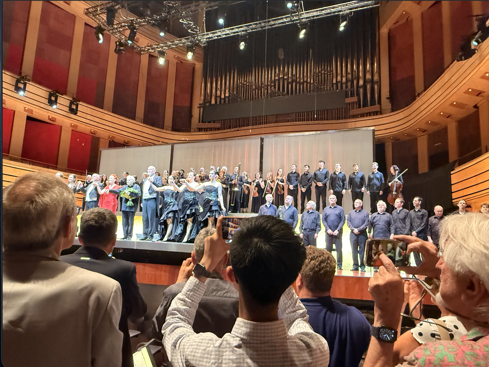

## 2026.10.9
[Stamement](https://www.ahmath.org/statements)

Days before AHM released a statement. Personally, I don't fully agree with it. But I support it in many aspects.

## 2026.9
I joined [Prof. Dr. Xiaopeng Li's](https://williampixell.github.io/) research group. I would do some work highly related to conserved quantities of first order method in non-convex optimization.

This shows some basic idea of the field I'm working on.[Symmetries, flat minima, and the conserved quantities of gradient flow](https://arxiv.org/abs/2210.17216)

## 2026.9.13
Days ago Terence Tao posted a declaration. 

[A Severe Misalignment of AI in Mathematics](https://mathandai.org/)

Here I'm going to support.

## 2026.9

I found that a Prof of CUHK-Shenzhen is researching on Asymptotic Behavior and Applications of a Class of First-Order Algorithms Based on Conservation Quantities in Nonconvex Optimization. I'll try to learn something from that.

## 2026.6.25-28

I attended Budapest Wagner Days in Budapest, Hungary.

## 2026.6

Recently I read some of Prof. Arnulf Jentzen's work, like [Convergence rates for Adam optimizers](https://arxiv.org/abs/2407.21078)... Quite interesting... he analysed where Adam convergence and how batch-size, third order moment of the noise influences it. 